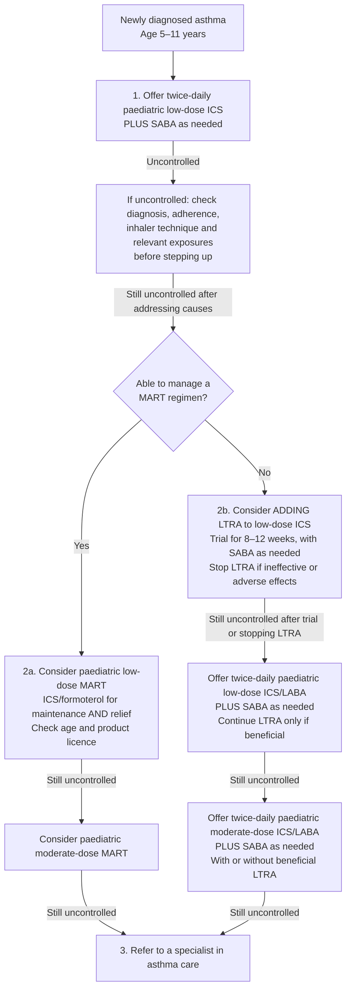

---
tags:
  - sca
  - asthma
  - paediatrics
verified: 2026-10-19
aliases:
  - Asthma management ages 5–11
---

# Asthma management — ages 5–11, non-acute
Based on the supplied image, checked against the BTS/NICE/SIGN pathway. This is the maintenance-treatment pathway for diagnosed asthma; acute attacks require separate assessment and treatment.

## Treatment pathway

Source: [NICE Algorithm D — children aged 5–11](https://www.nice.org.uk/guidance/ng245/resources/algorithm-d-pharmacological-management-of-asthma-in-children-aged-5-to-11-years-bts-nice-sign-pdf-13556516368).

## Review and safe use
- If controlled, maintain effective treatment and review; escalation is for persistent poor control after addressing contributing factors.
- Repeat the pre-escalation checks at each step. Review response 8–12 weeks after starting or changing treatment, with earlier assessment if clinically needed.
- Teach and check inhaler technique; use a spacer with a metered-dose inhaler where appropriate. Provide a personalised written action plan.
- Do not prescribe SABA alone without an ICS prescription. MART provides both maintenance and reliever treatment through the ICS/formoterol regimen.
- **MART licensing:** NICE's November 2025 update identifies one budesonide/formoterol dry-powder product, 100/6 micrograms per inhalation, licensed for MART at ages 6–11. Do not assume every product or use at age 5 is licensed; check the specific product and local pathway.
- **Montelukast:** explain possible changes in sleep, mood or behaviour. Stop treatment and seek prompt clinical advice if new or worsening neuropsychiatric symptoms occur, following MHRA advice.

Sources: [NICE NG245 — sections 1.6, 1.8 and 1.14](https://www.nice.org.uk/guidance/ng245/chapter/recommendations), [MHRA montelukast safety advice](https://www.gov.uk/drug-safety-update/montelukast-reminder-of-the-risk-of-neuropsychiatric-reactions).

## Abbreviations and examples
Terms used in the flowchart:

| Term | Meaning | Examples |
|---|---|---|
| ICS | Inhaled corticosteroid | Beclometasone, budesonide, fluticasone |
| SABA | Short-acting beta₂ agonist | Salbutamol |
| LABA | Long-acting beta₂ agonist | Formoterol; used with ICS in asthma |
| LTRA | Leukotriene receptor antagonist | Montelukast |
| MART | Maintenance and reliever therapy | A suitable ICS/formoterol combination used regularly and for relief |

Paediatric low/moderate ICS doses depend on the medicine, formulation and device; the examples are not dose-equivalent substitutions. [NICE guideline and dose resources](https://www.nice.org.uk/guidance/ng245).

Related notes: [[asthma- management 2024]], [[asthma- diagnosis (algorithm)]], [[asthma- acute attack]].
